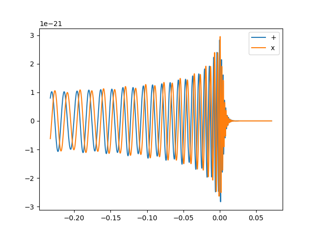

# nrcats

[](https://github.com/gwnrtools/nrcats/actions/workflows/python-test.yml)
[](https://gwnrtools.github.io/nrcats/)
[](https://gwnrtools.github.io/nrcats/)
[](LICENSE)

A stable, unified Python interface to public numerical-relativity (NR) binary black-hole
waveform catalogs, serving three overlapping communities:

- **LIGO-Virgo-KAGRA analyses** — reliable, PyCBC-compatible waveform and parameter access
  for parameter estimation, injection studies, and template bank construction
- **Waveform modeling** — consistent loading, physical scaling, and frame-alignment tools
  for calibrating and validating EOB, phenomenological, and surrogate models against any
  NR catalog
- **Cross-catalog studies** — tools to compare simulations across codes, including
  noise-weighted mismatch computation maximized over SO(3) rotations and BMS supertranslations

All three catalog backends expose an **identical interface**, so analysis code written
against one catalog works against all others without modification.

**Supported catalogs:**

| Catalog | Code | Example simulation name |
|---------|------|------------------------|
| [SXS](https://data.black-holes.org/waveforms/catalog.html) | SpEC | `SXS:BBH:0001` |
| [RIT](https://ccrg.rit.edu/content/data/rit-waveform-catalog) | LazEv | `RIT:BBH:0001-n100-id3` |
| [MAYA / GT](https://einstein.gatech.edu/catalog/) | MayaKranc | `GT0001` |

## Contents

- [Installation](#installation)
- [Quick Start](#quick-start)
- [Documentation](#documentation)
- [Building the docs locally](#building-the-docs-locally)
- [License](#license)

---

## Installation

```bash
pip install nrcats
```

Dependencies: `sxs >= 2025.0.0`, `pycbc`, `lal`, `h5py`, `quaternionic`, `spherical`, `scipy`.
See [docs/installation.md](docs/installation.md#dependencies) for the full list.

---

## Quick Start

```python
import nrcats as nrcat

# Load a catalog
ritcat  = nrcat.RITCatalog.load()
sxscat  = nrcat.SXSCatalog.load(download=False)
mayacat = nrcat.MayaCatalog.load()

# Browse simulations
print(ritcat.simulations_dataframe.index)
# Index(['RIT:BBH:0001-n100-id3', 'RIT:BBH:0002-n100-id0', ...], length=1879)

# Load a waveform
wfm = ritcat.get("RIT:BBH:0003-n100-id0")
print(wfm.LM)     # available (ell, m) mode pairs

# Extract a single mode in physical units
mode22 = wfm.get_mode(2, 2,
                      total_mass=60.0,   # M_sun
                      distance=100.0,    # Mpc
                      delta_t_seconds=1./4096)

# Get h+ and hx polarizations
pols = wfm.get_td_waveform(total_mass=40., distance=100.,
                            inclination=0.2, coa_phase=0.3)
hp, hc = pols.real(), pols.imag()   # h+ + i hx, the LALSimulation convention

# PyCBC-compatible source parameters
params = ritcat.get_parameters("RIT:BBH:0001-n100-id3", total_mass=60.0)
# {'mass1': 30.0, 'mass2': 30.0, 'spin1x': 0.0, ..., 'f_lower': 23.4}
```

```python
import matplotlib.pyplot as plt
plt.plot(hp.sample_times, hp, label='h+')
plt.plot(hc.sample_times, hc, label='hx')
plt.legend(); plt.show()
```



---

## Documentation

Full documentation: **<https://gwnrtools.github.io/nrcats/>**

| Document | Description |
|----------|-------------|
| [docs/index.md](docs/index.md) | Landing page: quick start and documentation map |
| [docs/installation.md](docs/installation.md) | Installation, dependencies, cache configuration |
| [docs/tutorials/](docs/tutorials/index.md) | Worked tutorials: loading, cross-catalog mismatch, surrogate comparison |
| [docs/catalogs.md](docs/catalogs.md) | Per-catalog reference: SXS, RIT, MAYA |
| [docs/waveform.md](docs/waveform.md) | `WaveformModes` conceptual guide |
| [docs/api/](docs/api/index.md) | API reference generated from source docstrings |
| [docs/architecture.md](docs/architecture.md) | Architectural overview and design decisions |
| [docs/package.md](docs/package.md) | Detailed package internals |
| [docs/goal.md](docs/goal.md) | Scientific motivation and mismatch formalism |
| [docs/contributing.md](docs/contributing.md) | Development setup, tests, docs builds |

---

## Building the docs locally

The site is built with [Jekyll](https://jekyllrb.com/) using the
[just-the-docs](https://just-the-docs.com/) theme; the API reference is generated
from docstrings by a [griffe](https://mkdocstrings.github.io/griffe/)-based script.

```bash
# 1. Regenerate the API reference pages (docs/api/*.md)
pip install griffe
python bin/generate_api_docs.py

# 2. Build and serve the site (needs Ruby >= 3.0)
cd docs
bundle install
bundle exec jekyll serve      # http://127.0.0.1:4000/nrcats/
```

The docs site is deployed automatically from `master` via GitHub Actions
(`.github/workflows/docs.yml`) whenever files under `docs/`, `nrcats/`,
`bin/generate_api_docs.py`, `CHANGELOG.md`, or `pyproject.toml` change.

---

## License

GPLv3 — see [LICENSE](LICENSE).
